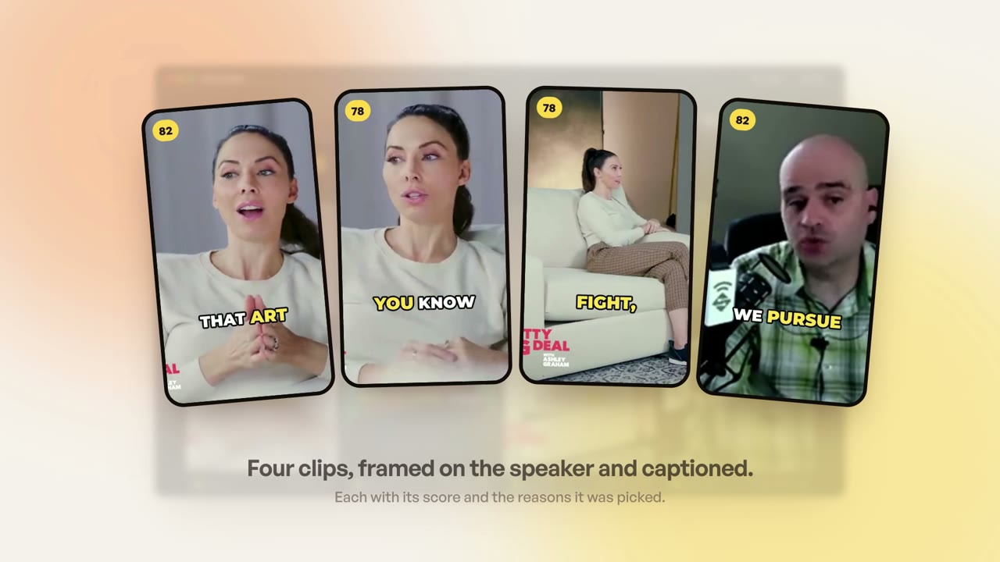

<p align="center">
  
</p>

<h1 align="center">choco.video</h1>

<p align="center">
  Long videos in. Clips out. On your Mac.<br>
  A free, open-source macOS app that turns a podcast, talk or stream into ranked, captioned, speaker-centred vertical clips.
</p>

<p align="center">
  <a href="https://github.com/YashvanthSankar/choco.video/releases/latest/download/choco.video-macos-arm64.dmg"><b>Download for macOS</b></a> ·
  <a href="https://chocovideo.vercel.app">Website</a> ·
  <a href="docs/TODO.md">What works today</a> ·
  <a href="CONTRIBUTING.md">Contribute</a>
</p>

---

## Why it exists

Opus Clip, Vizard and the rest upload your footage, meter it in credits and charge monthly. choco.video does the same job on your own machine, for free, with no account:

- **Your video never leaves your Mac.** Transcription, clip picking, face tracking, captions and rendering all run locally. The only thing that can go over the network is transcript text, sent to the clip picker *you* choose. Pick Apple's on-device model and nothing leaves at all.
- **Small.** About 20 MB installed, 10 MB download. No Python, no Ollama, no system FFmpeg, no bundled models. On macOS 26 the default path downloads nothing.
- **Pennies, paid to nobody here.** The clip picker is a language model. Use Apple Intelligence for free, or bring any OpenAI-compatible key (OpenCode Zen recommended, about 2¢ per hour of video) and pay that provider directly.
- **Honest output.** Every clip starts and ends on a complete thought, comes with its score and the picker's reasons, and ships with a poster, SRT and VTT subtitles, and a ready-to-paste caption.

## What it does

| Stage | What happens | Where |
|---|---|---|
| Transcribe | Word-timed transcript. Apple's speech engine on macOS 26+ (42× realtime, nothing to download), Whisper on older Macs | on device |
| Pick | Every stretch that starts and ends on a complete thought is a candidate. The best 80 go to your picker, which scores each one and says why | transcript text only |
| Reframe | A 233 KB face detector checks the frame five times a second and keeps whoever is talking in the vertical crop. Two people in one shot get a split | on device |
| Caption | Captions timed to the word in four styles (clean, bold, karaoke, minimal), drawn with bundled fonts so they look the same everywhere | on device |
| Render | Hardware H.264, sound at −14 LUFS, fast-start MP4. 9:16, 1:1, 4:5 or 16:9 | on device |

Measured on an M3 Pro: a 47:52 interview became four finished clips in 226 seconds, transcription included.

## Install

**App.** Download the DMG above, drag choco.video to Applications. The build is not notarized yet, so on first launch right-click the app and choose **Open**. Requires an Apple Silicon Mac on macOS 14 or later.

**CLI and engine, from source.**

```sh
brew install rustup pkg-config cmake nasm meson ninja && rustup default stable
./scripts/ffmpeg/build-mac.sh                      # minimal LGPL FFmpeg into vendor/ (once, ~10 min)
cd engine && cargo build --release
./target/release/choco doctor                      # what this Mac can do
./target/release/choco run talk.mp4 --picker apple -o clips
```

With a hosted picker:

```sh
export CHOCO_LLM_API_KEY=...        # read from the environment only, never written to disk
export CHOCO_LLM_MODEL=minimax-m3   # `choco provider models` lists what your endpoint offers
./target/release/choco run talk.mp4 --picker provider --prompt "clips about pricing" -o clips
```

Other commands: `transcribe`, `highlights`, `render`, `eval` (score a picker against the golden set), `models`, `provider test`. Each has `--help`.

**The app, from source.** Node 20+ with pnpm, then `./scripts/build-app.sh` produces `choco.video.app` and a DMG, verifies the signature and launches it once.

## Picker models

Measured on five public podcasts (5.2 hours). Precision at five is the share of the top five picks that match clips an editor marked; the set is not yet human-reviewed, so read it as a ranking.

| Model, on OpenCode Zen | Cost per hour of video | Precision at 5 |
|---|---|---|
| MiniMax M3 (recommended) | ~2¢ | 0.44 |
| DeepSeek V4.1 Flash | ~6¢ | 0.32 |
| Qwen 3.8 Flash | ~2.5¢ | 0.28 |
| Apple Intelligence, on device | free | not yet scored |

Any OpenAI-compatible endpoint works: OpenRouter, Groq, DeepSeek, or LM Studio and Ollama on your own machine.

## Repository

| Path | What | License |
|---|---|---|
| `engine/` | Rust engine, the `choco` CLI and a C FFI: ingest, transcribe, pick, reframe, caption, render, export, eval | MIT |
| `app/` | macOS app, Tauri 2 + Svelte 5, over the engine | MIT |
| `site/` | The website, static HTML, deployed to Vercel | MIT |
| `scripts/` | Minimal LGPL FFmpeg build, app bundling, size check | MIT |
| `docs/` | Plan, stack, technical spec, TODO with measurements, competitor notes | |
| `videos/` | The launch film, built with HyperFrames | |
| `brand/` | Logo explorations (the final mark is not chosen yet) | |

`AGENTS.md` is the project's working memory: non-negotiables, decisions and their reasons, measured benchmarks and known traps. Read it before changing anything substantial.

## Roadmap

Mac first. After the Mac app is solid: Windows (M6), then filler-word trimming, NLE export, speaker diarization and semantic search (M7). The full checklist with what is measured and what is not is in [`docs/TODO.md`](docs/TODO.md).

## Credits

FFmpeg (LGPL 2.1, dynamically linked, built with `--disable-gpl`), dav1d (BSD-2), whisper.cpp (MIT), the YuNet face detector from the OpenCV Zoo (MIT), Inter and Montserrat (OFL), General Sans on the site (Fontshare), cosmic-text, tract, Tauri and Svelte. Evaluation fixtures are CC BY recordings from Wikimedia Commons, credited in `engine/fixtures/sources.tsv`. Ideas borrowed with thanks from chopify, Klipzy Studio, AutoClip and OpenClip Studio (`docs/COMPETITORS.md`).

MIT licensed. See [`LICENSE`](LICENSE).
